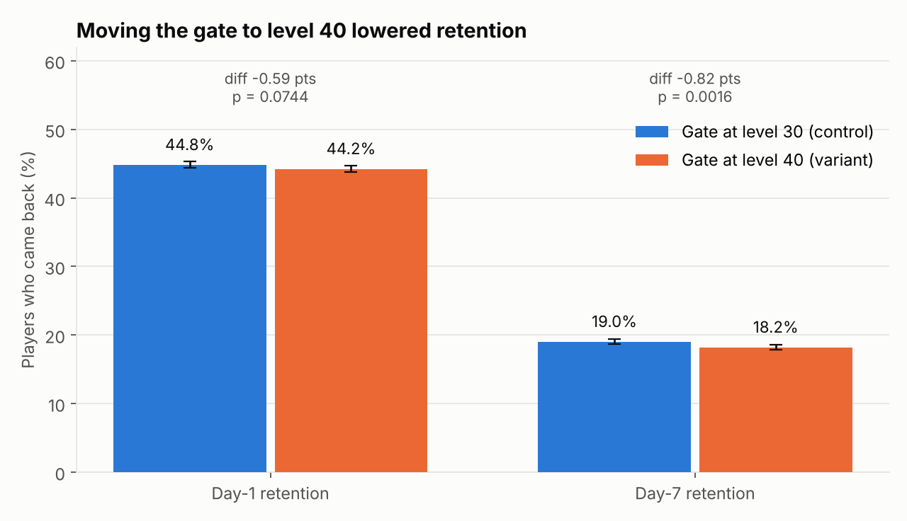
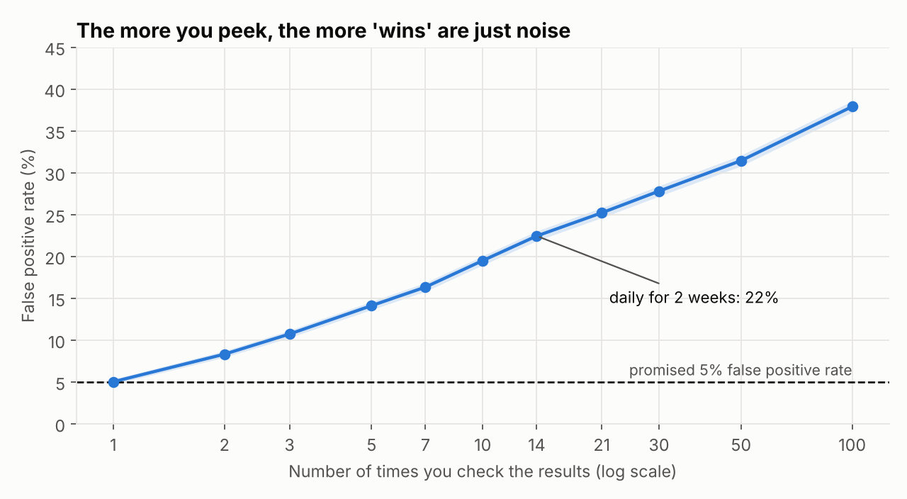
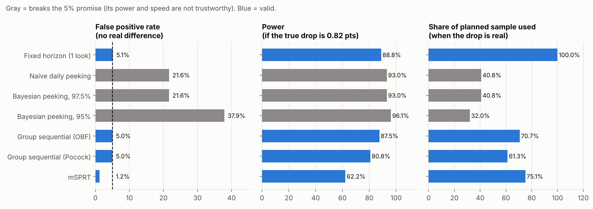

# Cookie Cats A/B Test: Analysis and the Peeking Problem

**Live App:** https://cookie-cats-ab-test1.streamlit.app/ 

A mobile game tested moving its first "gate" (a forced wait) from level 30 to level 40.
This project analyzes that experiment with 90,189 players, then uses simulation to show why
checking A/B test results early produces false wins, and how to fix it.

**Result: keep the gate at level 30.** Moving it lowered 7-day retention from 19.02% to 18.20%.



## In plain English

**The game.** Cookie Cats is a puzzle game. At certain levels, players hit a "gate" where they
have to wait or pay to keep playing. The company wanted to know if putting the first gate later,
at level 40 instead of level 30, would keep more players coming back.

**The test.** About 90,000 new players were randomly split into two groups. One group got the gate
at level 30 (the original), the other at level 40. Then the company tracked who came back 1 day
and 7 days after installing.

**What happened.** Moving the gate to level 40 made things slightly worse. 19.0% of level-30
players were still playing a week later, compared with 18.2% of level-40 players. That gap is
small, but with this many players it is very unlikely to be random luck. So the gate should stay
at level 30.

**One warning sign.** The two groups should be about the same size, but the level-40 group has
789 more players than the level-30 group, a bigger gap than a fair 50/50 split usually produces.
That can mean some players were logged wrong. I tested the worst case, and level 40 still doesn't come out ahead, but it's something the
company should check.

**The bigger lesson: don't peek.** Imagine flipping a fair coin and checking after every flip
whether you have "too many heads." Check often enough and you'll eventually see a streak, even
though the coin is fair. A/B tests work the same way. Standard tests promise only a 5% chance of a
false "win" if you look once at the end. I simulated 50,000 experiments with no real difference
and found that checking every day for two weeks raises that to **22%**, about 1 in 5 tests
declaring a winner that doesn't exist.

**The fix.** Sequential testing plans the check-ins ahead of time and makes the bar for "winning"
stricter early on. That keeps false wins at 5% while still letting a test stop early when the
effect is real. In the simulations it ended tests about 29% sooner on average.

Every technical term used below is explained in the [glossary](#glossary).

## Results

| Metric | Gate at 30 | Gate at 40 | Difference | p-value |
|---|---|---|---|---|
| Day-1 retention | 44.82% | 44.23% | -0.59 pts | 0.074 (not significant) |
| Day-7 retention | 19.02% | 18.20% | -0.82 pts | 0.0016 (significant) |

- **Data checks:** no duplicates or missing values. Sample ratio mismatch found (p = 0.009); a
  worst-case check shows it weakens but does not reverse the result.
- **Confidence intervals and bootstrap:** the day-7 drop is between 0.31 and 1.33 points
  (95% confidence). 99.9% of 100,000 bootstrap resamples show a drop.
- **Power:** the test could reliably detect a 0.73-point change in day-7 retention. Day-1 would
  have needed about 2.5 times as many players, so its non-significant result means "too small to
  measure here", not "no effect".
- **Bayesian:** 99.92% probability the level-30 gate has better day-7 retention.
- **Game rounds:** almost no difference (median 17 vs 16 rounds, p = 0.05).

## The peeking problem



A two-week test with daily checks was simulated 50,000 times using the real retention rate and
group sizes, then confirmed with 2,000 shuffles of the real data.

| Rule | False wins | Finds a real drop* | Players needed* |
|---|---|---|---|
| Look once at the end | 5.1% | 88.8% | 100% |
| Check daily, stop at p < 0.05 | **21.6%** | - | - |
| Bayesian, stop at 97.5% sure | **21.6%** | - | - |
| Sequential (O'Brien-Fleming) | 5.0% | 87.5% | 71% |
| Sequential (Pocock) | 5.0% | 80.8% | 61% |
| mSPRT (look any time) | 1.2% | 62.2% | 75% |

\*When the true drop is the observed 0.82 points. Rules that break the 5% promise are left blank
here, because they "find" effects that aren't there.

Two findings worth knowing:
- **Bayesian methods are not immune to peeking.** Stopping when you're "97.5% sure" behaves almost
  exactly like stopping at p < 0.05.
- **O'Brien-Fleming is the best trade-off here.** It keeps the 5% promise, loses only about 1 point
  of power, and usually stops early when the effect is real.



Full write-up with every number: [reports/FINDINGS.md](reports/FINDINGS.md)

## Interactive app

A Streamlit app with four parts: the results, a peeking simulator where you can change the
number of check-ins and watch false wins rise, a sample size calculator, and the glossary.

```bash
streamlit run app/streamlit_app.py
```

## Run it yourself

```bash
python3 -m venv .venv
source .venv/bin/activate               # Windows: .venv\Scripts\activate
pip install -r requirements.txt
python run.py                           # about 30 seconds; rebuilds results/, figures/, reports/
python -m pytest -q                     # 26 tests
```

All random steps use fixed seeds, so the results are the same every time.

## Project structure

```
data/raw/cookie_cats.csv     the experiment data (see data/README.md)
src/abtest/
    data.py                  load and check the data
    frequentist.py           sample ratio check, z-test, bootstrap, Holm, Mann-Whitney
    power.py                 minimum detectable effect, sample size, power
    sequential.py            sequential testing boundaries, mSPRT
    bayesian.py              Bayesian probabilities and expected loss
    simulate.py              peeking simulations and A/A tests
    analysis.py              runs the full analysis
    plots.py, report.py      charts and FINDINGS.md
run.py                       one command reproduces every result, chart and the report
app/streamlit_app.py         interactive app
tests/                       26 tests, checked against scipy, published values and simulation
results/                     output tables (CSV, JSON)
figures/                     charts
```

## Glossary

| Term | What it means |
|---|---|
| **A/B test** | Randomly split users into two groups, show each a different version, and compare results. |
| **Control / variant** | The original version (gate at 30) and the new version being tested (gate at 40). |
| **Retention (day-1, day-7)** | The share of players who came back and played 1 day or 7 days after installing. |
| **pts (percentage points)** | The plain difference between two percentages. 19.02% to 18.20% is a drop of 0.82 pts. |
| **p-value** | If there were truly no difference, how often you'd see a gap this big by luck. Below 0.05 is usually called "significant". |
| **False positive** | Declaring a winner when there is no real difference. Standard tests allow this 5% of the time. |
| **Confidence interval** | A range that likely contains the true difference. If it doesn't include 0, the difference is significant. |
| **Bootstrap** | Re-sampling the data many times to see how much the result could vary. A check that doesn't rely on formulas. |
| **Power** | The chance a test detects a real effect. 80% is the usual target. |
| **Minimum detectable effect (MDE)** | The smallest change a test is big enough to reliably detect. |
| **Bayesian analysis** | Instead of a p-value, gives the probability that one version is better than the other. |
| **Expected loss** | How much retention you'd expect to give up, on average, if you pick a version and it turns out to be the worse one. |
| **Sample ratio mismatch (SRM)** | The groups aren't the sizes the random split should produce. A warning sign of a bug in assignment or logging. |
| **Holm correction** | An adjustment for testing more than one metric, so you don't get extra false positives just from testing more. |
| **Mann-Whitney test** | Compares two groups without being thrown off by extreme values, like one player with 49,854 rounds. |
| **Peeking** | Checking results before a test is over and stopping as soon as it looks significant. |
| **A/A test** | A test where both groups get the same thing. Any "winner" is a false positive, so it measures how often a method is fooled. |
| **Permutation test** | Shuffling the real data between groups to create A/A tests, so results don't depend on a simulation's assumptions. |
| **Sequential testing** | Planning several check-ins ahead of time, with stricter rules early on, so peeking doesn't raise false positives. |
| **O'Brien-Fleming** | A sequential testing plan that is very strict early and close to normal at the end. |
| **Pocock** | A sequential testing plan with the same bar at every check-in. Easier to stop early, slightly harder at the end. |
| **mSPRT** | A method that lets you check results any time, as often as you want, without raising false positives. The trade-off is less power. |

## Limitations

- The data has no timestamps, so the timing of check-ins is simulated.
- The cause of the sample ratio mismatch can't be identified from this data.
- Retention is the only outcome; there is no revenue data.

## References

- Johari, Pekelis, Walsh (2017). Peeking at A/B Tests: Why it matters, and what to do about it. KDD.
- Lan, DeMets (1983). Discrete sequential boundaries for clinical trials. Biometrika.
- Jennison, Turnbull (2000). Group Sequential Methods with Applications to Clinical Trials.
- Kohavi, Tang, Xu (2020). Trustworthy Online Controlled Experiments.
